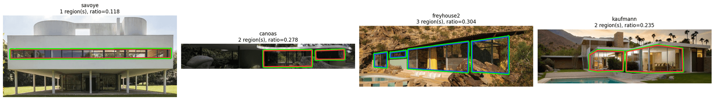
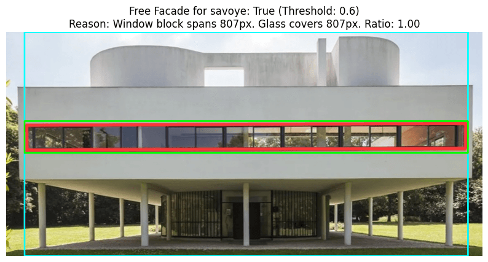
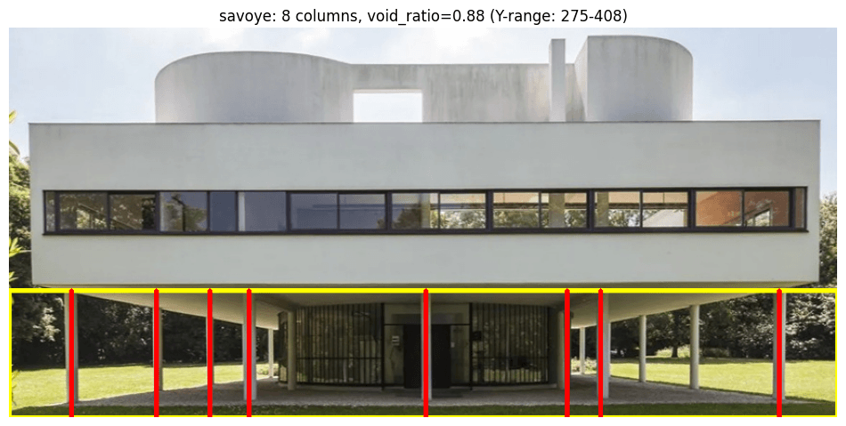
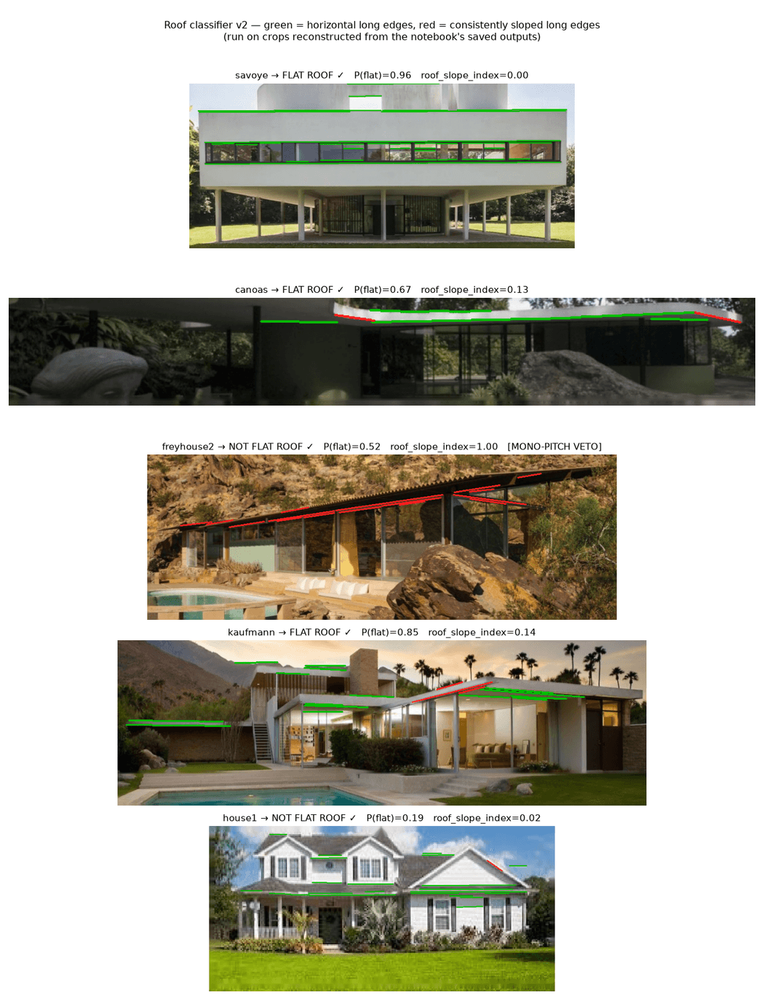
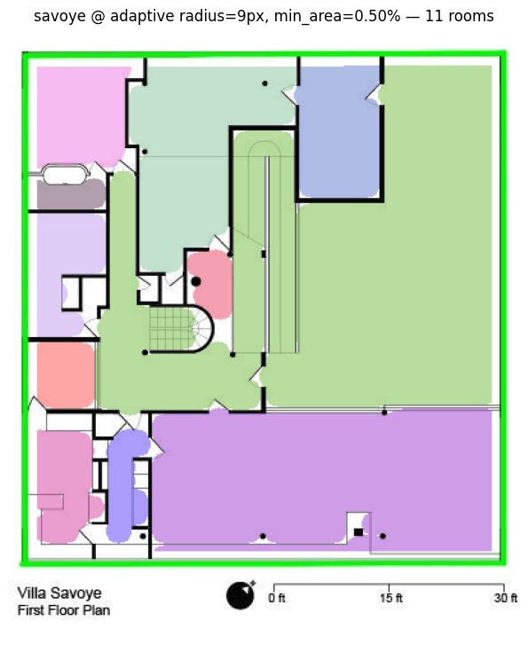
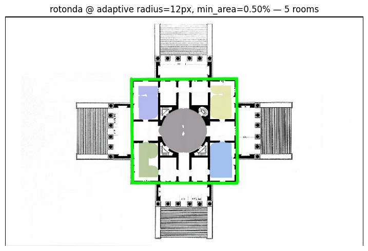

# 🏛️ Negotiated Modernism

> *Le Corbusier published Five Points of a New Architecture in 1927 as a universal prescription. What happens when a universal prescription is built in Poissy, in Rio de Janeiro, and twice in the Californian desert?*
> This project turns a manifesto into measurements — computer vision applied to four canonical modernist houses, asking which principles travel intact and which get quietly renegotiated by the local climate.

<p align="center">
  
</p>
<p align="center"><em>Hand-marked window regions extracted per building, and the resulting glazing ratios.</em></p>

---

## What This Is

A computer-vision pipeline that **operationalises** Le Corbusier's Five Points — pilotis, the free plan, the free facade, the ribbon window, the roof garden — into quantities that can actually be measured from photographs and floor plans, then applies them to four houses in four climates.

| Building | Architect | Location | Year |
|---|---|---|---|
| Villa Savoye | Le Corbusier | Poissy, France | 1931 |
| Casa das Canoas | Oscar Niemeyer | Rio de Janeiro, Brazil | 1953 |
| Kaufmann Desert House | Richard Neutra | Palm Springs, USA | 1946 |
| Frey House II | Albert Frey | Palm Springs, USA | 1964 |

Plus **Palladio's Villa Rotonda** as a negative control. A scoring rule that called the Rotonda "open plan" would be worthless, so it is in the pipeline specifically to fail.

Climate variables (mean temperature, solar radiation, sunshine hours) are fetched per building from its coordinates, so the architectural measurements can be read against the environment they landed in.

---

## The Pipeline

```
4 case studies + 1 control
        │
        ├──▶  Coordinates  →  climate API  →  temp / solar / sunshine
        │
        ├──▶  Exterior photographs
        │            ├──▶  Hand-marked windows  →  glazing ratio
        │            ├──▶  Hough transform      →  pilotis / column detection
        │            ├──▶  Drawn glass extent   →  free facade ratio
        │            └──▶  CLIP + geometric veto →  flat-roof classifier
        │
        └──▶  Floor plans
                     └──▶  Adaptive flood fill  →  room segmentation
                                 └──▶  area / density / convexity  →  open-plan score
```

---

## Glazing: the manifesto bends to the sun

<p align="center">
  
</p>

| Building | Glazing ratio | Climate |
|---|---|---|
| Villa Savoye | **0.118** | Poissy — 12.1 °C, 7.9 sunshine hrs/day |
| Kaufmann Desert House | **0.235** | Palm Springs — 23.9 °C, 11.3 hrs/day |
| Casa das Canoas | **0.278** | Rio de Janeiro — 20.8 °C, 9.6 hrs/day |
| Frey House II | **0.304** | Palm Springs — 23.9 °C, 11.3 hrs/day |

The ribbon window is the point of the Five that survives least intact. Savoye — the house that *defined* the ribbon window — glazes least of the four, at roughly a third to a quarter of the warm-climate houses. The principle travelled; the proportion did not.

---

## Free Facade

<p align="center">
  
</p>

Measured as the ratio of glass extent to the horizontal span of the window block — how completely the glazing runs across the facade it sits in.

| Building | Span | Glass | Ratio |
|---|---|---|---|
| Villa Savoye | 807 px | 807 px | **1.00** |
| Casa das Canoas | 508 px | 497 px | **0.98** |
| Frey House II | 724 px | 704 px | **0.97** |
| Kaufmann Desert House | 1200 px | 997 px | **0.83** |

All four pass. Unlike glazing *quantity*, the free facade as a *structural* idea — the wall no longer carrying load, so the window may run where it likes — transfers essentially unchanged across all four climates.

---

## Pilotis

<p align="center">
  
</p>
<p align="center"><em>Villa Savoye: 8 columns detected, void ratio 0.88.</em></p>

> ⚠️ **Read this before citing the pilotis numbers.** The detector is validated on Savoye alone. The search band for the other three sits over terrace, pool and lawn rather than a ground storey, so they report zero columns. That happens to agree with the architecture — only Savoye is genuinely raised on pilotis — but it is agreement by coincidence, not measurement. The zeros are not evidence.

---

## Flat Roof Classifier

<p align="center">
  
</p>

CLIP zero-shot scoring with a geometric veto from a roof-slope index, on 5 buildings including a pitched-roof negative.

| Building | Flat roof | p(flat) | Slope index | Veto |
|---|---|---|---|---|
| Villa Savoye | ✅ | 0.962 | 0.009 | — |
| Casa das Canoas | ✅ | 0.695 | 0.075 | — |
| Kaufmann Desert House | ✅ | 0.860 | 0.150 | — |
| Frey House II | ❌ | 0.486 | 0.967 | ✅ mono-pitch |
| Control (pitched) | ❌ | 0.256 | 0.000 | — |

**Accuracy: 5/5.** But Frey House II is decided on a CLIP margin of **0.03** — effectively a coin flip that the geometric veto rescued. One correct answer for the wrong reason.

---

## Open Plan

<p align="center">
  
  
</p>
<p align="center"><em>Left: Villa Savoye, largest room non-convex and dominant. Right: Villa Rotonda, convexity 1.00 — the control behaving as a control should.</em></p>

Floor plans are binarised, segmented into rooms by adaptive flood fill, and scored on three criteria:

- **Area** — does the largest room dominate the interior? (> 15%)
- **Density** — is internal partition density low? (< 20%)
- **Shape** — is the largest room non-convex? (convexity < 0.85), which distinguishes a flowing plan from one grand hall

> 🔴 **Results pending re-run.** The internal wall density rule was found to be structurally degenerate — it measured wall pixels *inside* a room blob, but a room blob is by construction a connected component of not-wall, so the value was always `0.000` and the rule awarded its 30 points unconditionally to every building. This is fixed in the current notebook, but the stored outputs predate the fix. **The open-plan scores must be regenerated before they are reported anywhere.**

The Villa Rotonda control still behaves correctly regardless — convexity 1.00, a perfectly convex central hall, correctly classified as not open plan.

---

## Setup

```bash
pip install open_clip_torch opencv-python-headless scikit-image pandas Pillow tqdm requests
```

The notebook expects a Google Drive folder laid out as:

```
negotiated_modernism/
├── images/          exterior photographs + *_marked + *_crop variants
└── plans/           floor plans + *_marked variants
```

Then run `NegotiatedModernism.ipynb` top to bottom.

---

## Known Limitations

- **Thresholds are hand-set, not learned.** Area > 15%, density < 20%, convexity < 0.85 were chosen by inspection. The Villa Rotonda control shows they are not arbitrary, but a single control is not a validation set.
- **n = 4.** Four houses cannot separate "climate" from "architect", "decade", or "client budget". Every correlation here is suggestive, not causal.
- **Pilotis detection is validated on one building.** See the warning above.
- **Otsu thresholding was tested and rejected** — these plans are line drawings, not photographs, so the bimodal intensity assumption Otsu depends on does not hold.
- **Hand-marked inputs.** Glazing and free-facade measurements depend on manually marked window regions, which introduces annotator judgement the pipeline cannot audit.

---

## Image Credits

Floor plans and exterior photographs are used for non-commercial academic analysis. Villa Savoye © Fondation Le Corbusier; Casa das Canoas © Fundação Oscar Niemeyer; Kaufmann Desert House © Richard Neutra estate; Frey House II © Palm Springs Art Museum.

---

## License

MIT — see [LICENSE](LICENSE).
